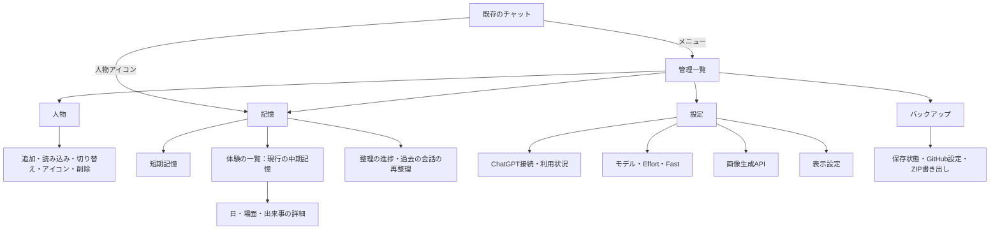
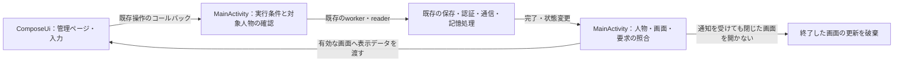

# Conversation：チャット以外の画面と操作導線の刷新

* **作成者：** tekewo000
* **状態：** 案A「目的ごとの管理一覧」に基づくUIを実装。エミュレーターのComposeテスト68件通過。Release対象はv0.9.0。
* **日付：** 2026-11-15
* **入力資料：** この会話でのユーザーの依頼、および現在の画面実装。
* **文書の範囲：** UIと操作導線の設計。現時点で実装や公開を完了したことを示す文書ではない。

## 概要

Conversationのチャット画面以外を刷新する。目的は、各所に散らばっている設定や管理操作を、利用者が目的から探せるようにすることにある。余白や色を整えるだけでなく、入口、画面の役割、情報の並び、戻る操作を見直す。

ユーザーは「チャット画面はそのままでおーけー」と指定した後、「記憶系ももちろん」「チャット画面以外全部刷新して」と範囲を明確にした。人物、記憶、接続、モデル、表示設定、画像生成API、バックアップ、およびそれらに付随する入力・確認・エラー表示を対象とする。

チャットの見た目と日常の会話操作は維持する。会話履歴、入力欄、人物アイコン、返信待ち・受信中の表示、添付、情景・メタ発言の送信を使い続けられることを前提とする。チャットにある既存の入口から管理画面へ進む先は、今回の刷新対象となる。

本書は今回の依頼から作る独立した設計書である。ルートにある `concepts_brief.md` と `design_draft.md` は以前の記憶・会話機能に関する資料であり、上書きせず、今回の画面構成への承認としても扱わない。

## 問題

### 設定の分類が、利用者の目的と一致していない

現在のメニューには、人物、表示設定、ChatGPT、画像生成API、Gitバックアップが同じ列に並ぶ。一方、記憶の入口は人物アイコンにあり、メニューから一覧できない。初めて使う人には、何をどこで確認・変更できるのか分かりにくい。

ChatGPTの画面には、接続情報、モデル、Effort、Fast、利用状況、ログアウトに加えて、記憶処理や端末内検索の状態も表示される。接続を確認したいときと、記憶の整理状況を確認したいときに、同じ情報の塊を読み分ける必要がある。

### 人物の管理と、記憶の閲覧・処理が混在している

記憶画面には、現在の感情・理由・状況、会話の整理件数、再整理の状態、短期記憶、中期記憶、人物アイコンの設定が集まっている。何を覚えているかを見る操作、処理の進み具合を見る操作、人物の外見を変える操作の境界が弱い。

記憶の閲覧には長い文章や階層がある。現在の共通パネルは、説明文と操作行を縦に並べる構造であり、長い内容、処理状況、階層内の現在位置を区別して示すには不足がある。ただし、すべてを専用画面へ変えれば解決するとは限らない。短い選択操作まで深い階層にすると、往復が増える。

### 画面を変えるだけでは、既存の操作や安全性を失う恐れがある

人物の切り替え、削除、接続の解除、APIキーの削除、過去の会話の再整理には、それぞれ実行条件や確認がある。刷新の過程で条件を落とすと、別人物の情報を表示したり、処理中のデータや下書きを失ったりする可能性がある。

記憶の整理済み件数は、保存や処理の進捗を表す。後の会話で正しく思い出せる割合ではない。新しい画面でも、表示しやすさのために、この違いを曖昧にしない。

## 目標

1. **目的から入口を見つけられる。** 人物の管理、記憶の閲覧と整理、接続・応答の設定、表示、バックアップについて、入口と担当画面を説明できる。記憶は人物アイコンを押す知識がなくても見つけられる。
2. **チャット以外を一貫した画面体系にする。** 管理画面の見出し、情報の強弱、現在値、選択状態、入力、確認、戻る操作を揃える。分類や名称を変えるだけで終了しない。
3. **記憶の内容と処理状態を読み分けられる。** 現在の状態、短期記憶、体験の一覧と階層、整理の進捗、過去の会話の再整理を区別する。対象人物を確認でき、階層をたどった後に直前の一覧へ戻れる。
4. **既存の機能を落とさない。** 人物の追加・切り替え・読み込み・削除、アイコンの設定、接続・解除、モデル・Effort・Fast、利用状況、画像生成APIの保存・削除、文字サイズ・間隔・初期値への復帰、Git保存・接続情報、ZIP書き出しを引き継ぐ。既存のエラー説明、処理中の制限、確認操作も含めて検証する。
5. **チャットへ戻って続けられる。** 管理画面を開閉しても、下書き、添付、表示中の会話、進行中の返信を意図せず失わない。人物切り替えなど、既存仕様として状態が変わる操作はその仕様を保持する。
6. **空・待機・処理中・失敗を区別できる。** 人物や記憶がない場合、未接続、情報の読み込み中、記憶の整理中、バックアップの失敗などで、状況と次に取れる操作を示す。接続が必要な操作は、その理由を表示する。
7. **内容が増えても操作できる。** 長い人物名、長文の記憶、体験の階層、大きなシステム文字、キーボード表示時でも、見出し、内容、戻る操作、確定・取消の操作に到達できる。タップと読み上げで現在値と操作対象を識別できる。
8. **保存済みデータと秘密情報を守る。** 人物ごとの会話・記憶・下書き、設定、認証、バックアップの対応関係を保持する。秘密情報を含む入力画面では既存の保護を維持する。

## 対象外

* チャット画面の配置、吹き出し、色、文字表現、入力欄、返信表示の刷新。既存の表示設定による調整機能は残す。
* 記憶の抽出・検索・階層化・人物像の変化の方式や、モデルへの指示の変更。記憶画面の刷新と記憶処理の改善を混同しない。
* DB、人物ファイル、バックアップ形式、認証方式、署名鍵の置き換えや、保存データの初期化。
* 記憶の手動編集・削除・固定、全文検索、グラフ表示など、現在の操作にない機能の自動的な追加。必要性が出た場合は既存機能の引き継ぎと分けて判断する。
* Androidのファイル選択画面、OAuth先のブラウザ、外部の利用状況・料金ページ自体の再設計。アプリから開く導線と説明は対象に含む。
* 画面の刷新だけを根拠に、記憶の正確さ、応答速度、長期的な人物の一貫性が改善したと主張すること。

## 選定した画面構成

2026-11-15、ユーザーが[画面構成の比較案](./screen_structure_options.md)のA「目的ごとの管理一覧」を選んだ。既存のメニュー操作から管理一覧を開き、「人物」「記憶」「設定」「バックアップ」へ進む。チャットにタブや新しい固定ボタンを追加しない。人物アイコンから記憶へ直接入る操作も残す。

画面構成の選択後、ユーザーが「実装して」と指定したため、設計用ワークフローから製品の実装へ移行した。以下の技術設計案を実装の方針とした。以前の文章修正案の一括適用や、独立した完成仕様レビューまで済ませたことは意味しない。B・Cを選ばなかった具体的な理由は、著者から確認していない。

## 技術設計案

### 画面と操作の流れ

管理一覧と各分類の内容、長い記憶の閲覧は、チャットを覆う不透明な専用ページとして表示する。短い選択、入力、実行前の確認は、そのページから開くパネルとして扱う。本文が長いほど大きなシートを重ねる構成にはしない。

| 画面 | 主に示す情報 | 操作と表示の分け方 |
|---|---|---|
| 管理一覧 | 現在の人物、4分類、接続・記憶整理・保存の短い状態 | 分類名を主、状態を補助にする。エラーの全文や設定項目をここへ詰め込まない。人物がいなくても一覧と共通設定は開ける |
| 人物 | 登録済み人物、選択中の人物、人物の追加・読み込み | 一覧の選択と人物アイコンの管理を分け、削除は通常の切り替えから離す。人物を選ぶだけの閲覧と、会話相手を切り替える操作を区別する |
| 記憶 | 対象人物、現在の感情・理由・状況、短期記憶、体験、整理状況 | 内容を読む入口と、処理を実行する入口を分ける。人物アイコンの変更は人物画面に集める |
| 短期記憶 | 現行の直近30往復、最大61発言 | 発言者と本文を別々の要素で表示し、新しいものから読む。コピー可能な本文と返信なしの注記を維持する |
| 体験の一覧と詳細 | 現行の中期記憶として表示する体験と、日・場面・出来事の階層 | 一覧は見出しと抜粋、詳細は全文と子の一覧を表示する。現実・創作・会話内の体験の区別を保持し、日時がないときに補わない |
| 設定 | ChatGPT、応答設定、画像生成API、表示の入口と現在値 | ChatGPT接続と有料画像生成APIを別の項目にする。記憶の進捗や端末内検索の状態は、記憶側へ移す |
| ChatGPTと応答設定 | 接続、利用状況、モデル、Effort、Fast | 未接続時はログインと利用条件を表示する。選択肢は既存のモデル一覧と対応能力を使い、設定変更の正規化も維持する |
| 画像生成API | 設定済みかどうか、モデル、保存・削除、料金への入口 | APIキーを含む入力は保護されたパネルで扱う。ChatGPTの利用枠とは別である説明を維持する |
| 表示 | 文字サイズ、メッセージの間隔、プレビュー、標準値への復帰 | 調整対象は既存と同じチャット表示。管理画面の文字サイズを、チャット向けの値に連動させない |
| バックアップ | 対象人物、端末保存とGit保存の区別、接続状態 | Git保存、トークン、ZIPの操作をまとめる。Git未登録の人物にも端末保存とZIPの使い方を示し、未実装の登録機能を追加しない |

### 戻る・閉じる・対象人物

ページの上部に、タイトルと「戻る」を常に置く。記憶、人物アイコン、バックアップなどの人物に属する画面では対象人物の名前も表示する。長い名前は複数行で扱い、戻る操作を押し出さない。

端末の戻る操作と画面内の戻る操作は同じ遷移にする。入力や確認が開いていればそれを閉じ、次に詳細から親の一覧へ、分類から管理一覧へ、管理一覧からチャットへ戻る。ページ外のタップで専用ページ全体を閉じる操作は設けない。

人物アイコンから記憶へ直接入った場合、記憶の入口からの戻り先はチャットになる。体験の詳細からは一つ前の体験の一覧または親の詳細へ戻す。子の一覧をページ送りした場合も、直前の親画面と閲覧位置へ戻れるようにする。

一覧の閲覧位置は、管理画面を開いている間、戻り先ごとに保持する。通常の画面更新や記憶整理の通知だけでは、閲覧中の階層や位置を変えない。人物の切り替えやActivityの再生成をまたいで、管理中の詳細や秘密入力を復元することは今回の要件にしない。

人物切り替え・作成・削除によって既存処理がActivityを再生成した場合は、確定後の人物のチャットを表示する。古い人物のページ履歴は引き継がない。切り替え前の下書き保存、処理中の制限、削除の確認などは現在の処理を使う。

### 見た目と情報の階層

管理画面は、タイトル、短い状態、分類ごとの内容、操作という順序を揃える。暗い背景、明るい本文、控えめな緑の操作色でチャットとのつながりを持たせるが、会話の吹き出しを管理画面へ流用しない。各行の主ラベルと補助説明を分け、全項目を同じ大きさの長文リンクとして並べない。

管理一覧は大きな飾りやカードの積み重ねではなく、4分類が見渡せる一覧にする。状態は「未接続」「整理中」「端末のみ」など、現在のデータから説明できる短い表示に限定する。色だけで状態を伝えず、文字も付ける。

記憶の内容は選択・コピーできる本文として扱い、整理の進捗は別の短い領域に置く。整理中の件数が更新されても、本文や子の一覧を先頭から作り直さない。件数を記憶の正確さや、バックアップ完了の割合として表示しない。

共通の上部領域、一覧行、説明、入力、選択、確認操作を再利用する。システムの文字拡大に従い、固定の高さで本文を切らない。長い本文と多数の行はスクロールでき、キーボード表示時にも確定・取消へ到達できるようにする。色や余白の正確な値は、詳細実装計画で管理画面用の値として定義する。

### 既存コードとの分担

保存、認証、通信、人物の選択、記憶処理の制御は、現在と同じく `MainActivity` と既存サービス群に残す。描画、画面の履歴、スクロール、パネル、フォーカスは `ComposeUi` の表示状態として扱う。新しいActivity、外部の画面遷移ライブラリ、状態管理のための別基盤は、この案では追加しない。

`ComposeUi.Content` のチャットは同じ構成のまま保持し、その上に管理ページを描画する。管理中はチャット側のタップ、キーボードフォーカス、読み上げ対象への到達を遮断する。チャットを閉じて再生成することで画面を切り替えないため、入力中の文字、添付、履歴の閲覧位置、返信の表示状態をそのまま保つ。返信とバックグラウンドの記憶整理は、既存の実行条件の範囲で続ける。

既存の `Panel`、`Row`、`Field`、`Setting` の表示データとコールバックを再利用し、管理ページ用にタイトル、対象人物、状態の説明、主ラベルと補助説明、戻り先を扱えるようにする。専用ページの描画と、選択・入力・確認パネルの描画は分ける。秘密入力は現在の保護されたダイアログを維持し、通常のページへ直接埋め込まない。

秘密入力はマスクし、保護された画面ではスクリーンショットを抑止する。入力値はActivityの保存状態や管理ページの履歴に格納しない。入力を取り消したときやページを離れたときは、その入力中の値を破棄する。既存の保存済みキーは、現在の「空欄なら保持」などの規則に従って扱う。

JNI、DB、人物ファイル、Git/ZIPの保存形式、モデルへのリクエスト形式、認証とKeystoreの規則は変更しない。JavaとKotlin間では管理ページの表示データと戻る通知を拡張するが、現在のサービスAPIを新しいUI専用の形へ作り替えない。

### 非同期更新と失敗時の扱い

現在の `memoryView`、`episodeRequest`、人物ID照合が担う保護を、新しいページの表示状態と結び付ける。操作の開始時に対象人物、表示先、要求を識別し、結果を画面へ適用するときに照合する。ページを閉じた後や別の人物へ変わった後の結果で、そのページを再度開かない。

画面の履歴と表示先の識別は `ComposeUi` 側にまとめ、`MainActivity` は読み取り開始時に表示先の識別を受け取る。ページ更新のために履歴を追加しない。閉じる・戻る操作で表示先を無効にし、進捗の更新と画面の移動を別の操作として扱う。記憶整理の通知が来たときも、現在開いている対象にだけ更新を適用する。

保存や処理の実行結果と、画面へ表示してよいかは区別する。画面を閉じても、すでに実行を承認した既存の保存処理を表示制御だけの理由で失敗扱いにしない。完了状態は既存の保存先・状態へ反映し、次に該当画面を開いたときに読み直す。新しい永続通知一覧は追加しない。

| 状態 | 表示と取れる操作 |
|---|---|
| 人物がいない | 管理一覧・人物・共通設定は開ける。記憶とバックアップは人物が必要な理由を示し、人物の追加・読み込みへ進める |
| 記憶が空 | 「まだ記録がない」と表示する。読み取り失敗や整理未完了と同じ文言にしない |
| 読み込み中 | 開いた画面に読み込み中を表示する。利用できない操作を実行せず、戻る操作は残す |
| 記憶の整理中 | 対象人物と現在取得できる件数・状態を表示する。既存と同じ二重要求の防止を保ち、チャットへ戻れる |
| 未接続・設定不足 | 必要な接続と理由を示す。設定が不要な閲覧や端末のデータ確認は利用できる |
| 読み取り失敗 | 対象画面にエラーと再読み込みを示す。空の記憶と扱わず、戻る操作を残す |
| 外部画面を取り消した | 変更を確定せず元の管理画面へ戻る。既存の人物IDとファイル選択の対応を維持する |
| 保存・再整理などの失敗 | 機密情報を含まない既存のエラー説明を表示する。再試行で重複実行しないよう、処理中の制限と照合する |

### 変更対象と確認する操作

この技術設計案の製品側の変更対象は、既存の次の4ファイルを中心とする。具体的な追加項目、作業順、文書と検証記録を含めた全ファイル一覧は、詳細実装計画で確定する。

* [MainActivity.java](../../../android/src/jp/tekewo/conversation/MainActivity.java)：管理の入口、目的ごとの表示データ、画面遷移と非同期更新の照合、既存の操作の接続。
* [ComposeUi.kt](../../../android/src/jp/tekewo/conversation/ComposeUi.kt)：管理ページと履歴、共通の見出し・一覧・状態表示、戻る操作、フォーカス、既存パネルの再利用。
* [MainActivityComposeTest.kt](../../../android/compose-tests/jp/tekewo/conversation/MainActivityComposeTest.kt)：管理一覧から各機能へ進む操作、人物の照合、記憶の階層と更新、既存操作の引き継ぎ。
* [ComposeUiTest.kt](../../../android/compose-tests/jp/tekewo/conversation/ComposeUiTest.kt)：画面とパネルの表示、戻る・閉じる、閲覧位置、チャット状態の保持、読み上げと秘密入力。

主な受け入れ操作は、管理一覧から4分類へ進んでチャットへ戻ること、人物アイコンから記憶へ直接入り元へ戻ること、体験の子の詳細とページ送りをたどって元の位置へ戻ること、返信・記憶整理中に管理画面を開閉することとする。

これに、人物切り替え後に前人物の読み取りが完了する場合、管理画面を閉じた後に通知が届く場合、空とエラー、未接続、長文、大きな文字、キーボード、秘密入力を加える。既存テストは新しい画面の表示に合わせて更新するが、送信、返信待ちの行、受信中のスクロール、下書き、添付、人物ごとの保存などの既存の期待を都合よく削除しない。

実装後は既存のComposeテストを使い、必要なエミュレーター検証を行う。実機での視認性と操作感は別に確認する。Releaseビルドを行う場合には、リポジトリの公開・署名済みAPK検証の手順も満たす。この文書更新ではビルドも公開も行わない。

## 残る確認事項

* 実装はユーザーの明示的な実装依頼に基づく。EGMの節ごとの承認と詳細実装計画書の作成をすべて完了したと扱わない。
* 人物中心の案Bと管理内タブの案Cを選ばなかった著者の理由を確認し、代替案の節へ記録する。技術的なトレードオフを著者の発言として捏造しない。
* [レビューの文章修正案](./goldfish_review_report.md)は未承認・未適用のまま。概要の用語や表現を、今回の構成選択を理由に一括置換しない。技術設計内では必要な用語をその場で説明する。
* 添付・情景/メタ発言・再試行の補助パネルの外観を刷新する範囲は、未適用の修正案E5で提案されている。承認まで、共通パネルの変更を理由にチャット補助操作へ変更を波及させない。
* 画面のデータ、色・余白・文字、操作テストは `ComposeUi.kt`、`MainActivity.java` と両Composeテストに実装した。実行結果と未検証の範囲は [検証記録](../../validation.md) の2026-11-15の管理画面刷新の項目に記録した。

## 確認した実装

* [MainActivity.java](../../../android/src/jp/tekewo/conversation/MainActivity.java)：メニュー、人物、記憶、モデル、接続、表示、画像生成API、バックアップの各操作。
* [ComposeUi.kt](../../../android/src/jp/tekewo/conversation/ComposeUi.kt)：チャットと共通パネルの描画、入力・選択・確認の表示。
* [MainActivityComposeTest.kt](../../../android/compose-tests/jp/tekewo/conversation/MainActivityComposeTest.kt)：既存の記憶画面と管理操作を含むテスト。
* [ComposeUiTest.kt](../../../android/compose-tests/jp/tekewo/conversation/ComposeUiTest.kt)：チャット表示、パネル、フォーカス、操作のテスト。

この段階では実装を読んで要件を整理した。テストの再実行、端末での操作確認、表示の評価は行っていない。

---

*EGMの草案と画面構成Aを起点に、ユーザーの実装依頼で製品の実装へ移行した。正式な代替案の節と詳細実装計画書は未作成。*
